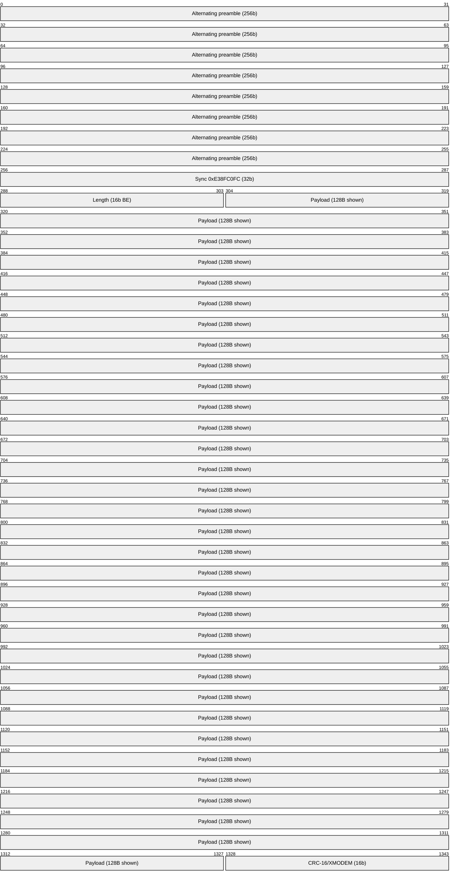
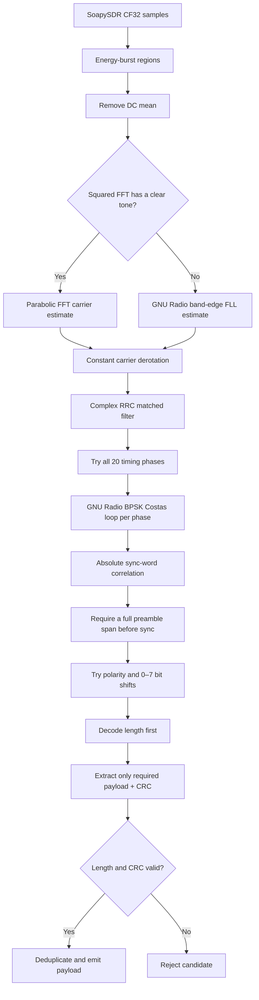

# Packet RF Link — Validated BPSK Baseline

This folder contains the hardware-validated packet telemetry link introduced by
commit `68a4c89` (`feat(rf-link): establish hardware-validated BPSK packet
baseline`). It is the known-good starting point for future RF-link work.

The production path is `src/pkt_simple_tx.py` + `src/pkt_simple_rx.py`. Despite
the `simple` name, this is the active implementation. The `pkt_enhanced_*`,
`packet_codec.py`, and `fec_cc.py` files are an experimental CRC-32/FEC path and
are **not** part of this baseline.

## Baseline at a Glance

| Property | Baseline value |
|---|---|
| Modulation | BPSK, `0 -> +1`, `1 -> -1` |
| Symbol rate | 100 ksym/s |
| Sample rate | 2 Msps |
| Samples per symbol | 20 |
| Pulse shaping | Root-raised cosine, alpha 0.35, `11 * SPS = 220` taps |
| Sync word | `0xE38FC0FC` (32 bits) |
| Preamble | 256 alternating bits (`10` repeated) |
| Length | 16-bit unsigned big-endian |
| Payload accepted by RX | 1–128 bytes |
| Integrity | CRC-16/XMODEM over payload only |
| Forward error correction | None |
| Carrier acquisition | Squared-signal FFT; GNU Radio FLL fallback |
| Carrier tracking | GNU Radio order-2 Costas loop |
| Timing acquisition | Evaluate all 20 symbol-sampling phases |

The tested hardware configuration uses two HackRF Ones connected through an
appropriate SMA cable/attenuation path at 433.5 MHz. The live tools default to
915 MHz, so always pass `--freq 433.5e6` when reproducing the cable test setup.

## Packet Format

All multibyte values and bytes are sent most-significant bit first.

```text
| alternating preamble | sync word | payload length | payload | CRC-16/XMODEM |
|       256 bits        |  32 bits  |    16 bits     |  8*N    |     16 bits    |
|      0xAA...          | E38FC0FC  |  big-endian    | 1–128 B |  payload only  |
```

The total packet size is `320 + 8*N` symbols. A maximum-size 128-byte packet is
1,344 symbols, or 26,880 samples / 13.44 ms at the baseline rates.



## Transmit Pipeline

`pkt_simple_tx.make_packet()` constructs the frame and returns a precomputed
complex64 waveform. The command-line transmitter repeats bursts through a GNU
Radio vector source and SoapySDR HackRF sink.

```mermaid
flowchart LR
    A[Payload bytes] --> B[CRC-16/XMODEM]
    B --> C[Length + payload + CRC]
    C --> D[Add 256-bit preamble]
    D --> E[Add 32-bit sync]
    E --> F[BPSK mapping]
    F --> G[Upsample x20]
    G --> H[RRC pulse shaping]
    H --> I[complex64 IQ waveform]
    I --> J[GNU Radio vector source]
    J --> K[SoapySDR HackRF sink]
    K --> L[RF]
```



For packet bursts, `make_test_packets()` places exact-zero gaps between packet
waveforms. `--gap 0` makes the packets contiguous; `--gap 50` uses the baseline
50 ms gap.

## Receive Pipeline

Live IQ arrives directly from SoapySDR. The decoder first isolates energy
bursts when clear gaps exist; continuous captures are processed as one region.
Each region then follows the same production decode path.



The decoder returns only CRC-valid packets. Correlation finds candidates; it
does not make a packet valid by itself.

## Why FFT, FLL, and Costas Are All Present

These blocks solve different parts of carrier recovery rather than competing
for the same job.

| Stage | Implementation | Role |
|---|---|---|
| Primary acquisition | NumPy squared-signal FFT | Removes BPSK data modulation by squaring, finds the resulting tone at twice the carrier offset, then divides by two. Four-times zero-padding and parabolic peak interpolation provide a precise one-shot estimate. |
| Acquisition fallback | GNU Radio `digital.fll_band_edge_cc` | Supplies a coarse estimate when the FFT peak is not at least five times the spectral median. The original samples are then derotated using that estimate. |
| Residual tracking | GNU Radio `digital.costas_loop_cc` | Tracks phase and small residual frequency error at symbol rate after coarse derotation and timing-phase selection. Order 2 is the BPSK detector. |

The squared estimator fixed the independent-HackRF oscillator offset that
limited the earlier receiver to roughly five-byte payloads. The Costas loop is
still useful: it removes residual phase motion over long packets after the
one-shot estimate. Removing either stage would define a new, unvalidated
receiver architecture.

## GNU Radio and SoapySDR Usage

The baseline does use GNU Radio, but it is assembled from Python rather than a
GNU Radio Companion flowgraph.

- TX: `gr.top_block`, `blocks.vector_source_c`, `blocks.throttle`, and
  `soapy.sink`.
- RX DSP: `digital.fll_band_edge_cc`, `digital.costas_loop_cc`, vector
  source/sink blocks, and `firdes.root_raised_cosine`.
- Live RX hardware: native Python SoapySDR calls.
- Layer 3 TX: `hackrf_transfer` with a generated interleaved IQ8 file.

NumPy implements packet construction, burst segmentation, the primary carrier
estimator, derotation, convolution, correlation, bit extraction, and CRC.

## Active Files

```text
packet/
├── README.md                       # This baseline guide
├── src/
│   ├── pkt_simple_tx.py            # Active packet builder and live TX
│   ├── pkt_simple_rx.py            # Active decoder and live RX
│   ├── pkt_enhanced_tx.py          # Experimental; not baseline
│   ├── pkt_enhanced_rx.py          # Experimental; not baseline
│   ├── packet_codec.py             # Experimental CRC-32/FEC codec
│   └── fec_cc.py                   # Experimental convolutional FEC
├── test/
│   ├── test_layer1_simple.py       # 16 framing/CRC unit tests
│   ├── test_layer2_simple.py       # 14 production software-loopback tests
│   └── test_layer3_simple.py       # 6 two-HackRF acceptance tests
└── original/                       # Archived pre-baseline reference scripts
```

The older material in `docs/`, `debug/`, and the non-`simple` test files mostly
describes the experimental enhanced path. Use this README and the three
`*_simple.py` tests as the source of truth for the validated baseline.

## Running the Baseline

Commands below assume the repository's `rf/` directory is current and use the
Homebrew Python installation under which GNU Radio and SoapySDR were validated.

Start the receiver:

```bash
/opt/homebrew/bin/python3.14 packet/src/pkt_simple_rx.py \
  --freq 433.5e6 \
  --serial 60a464dc3606610f \
  --lna 32 \
  --vga 40 \
  --amp \
  --duration 0
```

Start the transmitter in another terminal:

```bash
/opt/homebrew/bin/python3.14 packet/src/pkt_simple_tx.py \
  --freq 433.5e6 \
  --serial 60a464dc3674640f \
  --vga 47 \
  --amp \
  --message "HELLO" \
  --gap 50
```

Before a hardware test, confirm both radios enumerate:

```bash
hackrf_info
```

The validated serial mapping is:

| Role | Significant serial suffix | Firmware |
|---|---|---|
| TX | `60a464dc3674640f` | v2.0.1 |
| RX | `60a464dc3606610f` | 2024.02.1 |

## Acceptance Tests

```bash
# Layer 1: framing, length, CRC, waveform, and silence rejection
/opt/homebrew/bin/python3.14 packet/test/test_layer1_simple.py

# Layer 2: complete production waveform-to-payload software loopback
/opt/homebrew/bin/python3.14 packet/test/test_layer2_simple.py

# Layer 3: two-HackRF SMA loopback; each test runs in an isolated process
/opt/homebrew/bin/python3.14 -u packet/test/test_layer3_simple.py
```

Layer 3 prints `SKIP` when the configured serials are unavailable. A skipped
suite is not hardware validation; all six rows must print `OK`.

The baseline acceptance run on 2026-07-19 produced:

| Layer | Result | Important coverage |
|---|---|---|
| Layer 1 | 16/16 | CRC vector, length, sync, packet/burst shape, silence rejection |
| Layer 2 | 14/14 | 1–128 B, noisy gaps, binary data, CRC rejection, ±8 kHz offset, 15 dB AWGN |
| Layer 3 | 6/6 | 836/836 short decodes, 20/20 unique frames, zero noise false positives |
| Layer 3 long payload | `[20, 20, 20]` | Unique 128-byte packets recovered in three runs; requirement is at least 18/20 per run |
| Layer 3 gain margin | TX VGA 10 | Decoded at each tested setting from VGA 47 down to 10 |

## Baseline Boundaries

- CRC-16 detects corrupt payloads; it does not repair them.
- The CRC covers the payload, not the length field. Length bounds and CRC
  validation jointly gate acceptance.
- The decoder accepts payload lengths 1–128 bytes. Treat larger or empty
  payloads as unsupported even though the TX helper can construct them.
- The carrier acquisition search is bounded to approximately ±10 kHz.
- Timing is acquired by evaluating the 20 fixed SPS phases; there is no timing
  recovery loop in this baseline.
- Hardware validation is a cabled bench result, not an over-the-air link-budget
  result.
- The same baseline commit wires the dashboard receiver manager to launch
  `pkt_simple_rx.py`, but dashboard parsing/ingestion is outside the three RF
  acceptance layers and is not claimed as hardware-validated here.
- Protect SDR inputs with appropriate attenuation and verify power levels
  before changing gains or replacing the bench cable path.

Future improvements should start from this commit, add a failing Layer 1 or
Layer 2 test first, and finish with all six Layer 3 checks when RF behavior is
affected.
